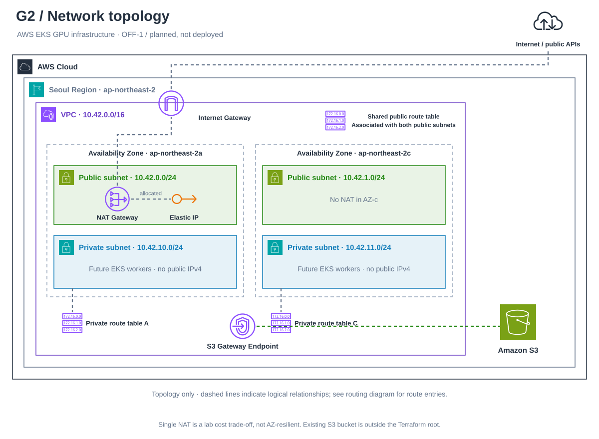

# G2 Terraform — OFF-1: network and EKS control plane (not deployed)

> **Status (2026-11-26): Network source passed local init/fmt/validate with Terraform 1.17.2 and AWS provider 6.74.0. EKS control plane source is added; its local validation is pending. No AWS resources created.** Don't run `terraform apply` yet. Terraform state is not committed.

## Logical network design



[Editable draw.io source](../../docs/diagrams/g2/01-network.drawio)

**Detailed routing diagram (study reference):** [SVG](../../docs/diagrams/g2/01-network/with-route-tables.svg) · [Editable draw.io](../../docs/diagrams/g2/01-network/with-route-tables.drawio). Includes the shared public route table and both private route tables. The main diagram omits those nodes for readability.

The integrated diagram combines resource placement and route targets in one view. This is a planned design, not deployed infrastructure. Private subnets are reserved for future workers; their placement is not fixed. Colored arrows indicate route targets, not physical hops. The S3 gateway endpoint is VPC-scoped and associated with both private route tables.

- Private nodes will have **no public IPv4**. NAT in public subnet allows public API, ECR and internet egress (but not unsolicited inbound).
- **S3 Gateway Endpoint** is associated with *both* private route tables. AWS installs S3 prefix-list routes; S3 GetObject/PutObject uses endpoint rather than NAT. S3 IAM and bucket policy remain separate.
- The IGW is attached to the VPC. The NAT Gateway has an Elastic IP and lives in public AZ-a subnet; public route table `0.0.0.0/0 → IGW`.
- Single NAT is cheaper in number of gateways, but **not AZ resilient**, and cross-AZ network transfer may cost extra.
- Network code does not create an EKS Cluster, private API endpoint, security groups, IAM roles or nodes. These belong to the next steps.
- The CIDR is a *proposed lab CIDR*; verify there is no overlap with any peering/VPN/on-prem networks before applying.

## EKS control plane (source only)

- [`eks.tf`](eks.tf): cluster IAM role, AmazonEKSClusterPolicy attachment, managed EKS cluster in both private subnets.
- Public and private Kubernetes API access enabled; administrator public IPv4 `/32` CIDRs must be supplied as `admin_access_cidrs`. Worker API traffic uses the private endpoint.
- AWS-created cluster security group; API authentication with creator-admin bootstrap for this lab. Standard support only; specify a currently supported `eks_version` before planning.
- The network diagram above is the network-stage snapshot; an expanded control-plane diagram is pending.
- Node groups, Pod Identity and add-ons remain future work.

## Local read-only checks (no AWS resources created)

```bash
cd infra/g2
terraform init -backend=false
terraform fmt -check
terraform validate
```

`terraform init -backend=false` downloads providers but does not create AWS resources; `terraform validate` checks configuration locally. The next stage adds node groups, pod IAM and add-ons. **Do not run `terraform apply` or create chargeable NAT/EIP until the full G2 ON checklist is complete**.

Once all stages are prepared, inspect `terraform plan` against the target AWS account and region, confirm budget/cleanup and backup, then explicitly proceed to `apply`.

## Design notes

- AWS Region: ap-northeast-2; two subnets each in AZ 2a, 2c, in one VPC.
- Existing G1 S3 bucket is not created or modified by this Terraform root.
- Public EKS API access for WSL `kubectl` is restricted to supplied administrator IPv4 /32 CIDRs; private endpoint is enabled.
- G2 Batch 32/64/128/256 capacity tests and actual YOLO Job are **later G2 ON tasks**, not part of this networking stage.
